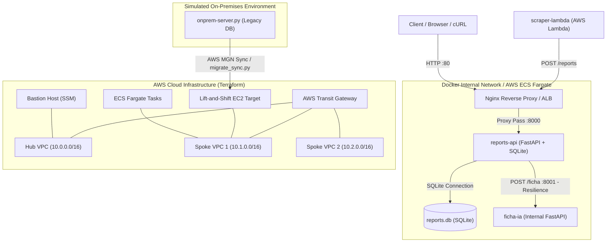

# huellamap-lite

`huellamap-lite` is a lightweight monorepo designed to demonstrate core cloud resilience patterns and distributed cloud architecture in a reproducible environment, featuring minimal, readable, and functional code across all components.

## System Architecture



## Architecture Patterns & Status (Minimal Code Implementation)

| # | Topic / Pattern | Status | Code Location | Implementation Details |
|---|-----------------|--------|---------------|------------------------|
| 1 | **Circuit Breaker** | Implemented and executed | [reports-api/main.py](reports-api/main.py) | Custom state machine (`CLOSED`, `OPEN`, `HALF_OPEN`). Opens after 3 consecutive failures, holds for 15s, transitions to `HALF_OPEN`. Queryable at `GET /breaker`. |
| 2 | **Retry** | Implemented and executed | [reports-api/main.py](reports-api/main.py) | 3 retry attempts with exponential backoff (`0.5 * 2^(attempt-1)` seconds). |
| 3 | **Timeout** | Implemented and executed | [reports-api/main.py](reports-api/main.py) | Strict 2.0s HTTP client timeout on `ficha-ia` calls using `httpx.Client(timeout=2.0)`. |
| 4 | **Serverless (Lambda) & Docker / ECS** | Implemented and executed | [scraper-lambda/handler.py](scraper-lambda/handler.py)<br>[docker-compose.yml](docker-compose.yml)<br>[terraform/ecs/main.tf](terraform/ecs/main.tf) | AWS Lambda handler for automated report submission, multi-container Docker Compose, and Terraform definitions for AWS ECS Fargate Cluster, Task Definition, and Service. |
| 5 | **API Gateway, Load Balancer & Reverse Proxy** | Implemented and executed | [nginx/nginx.conf](nginx/nginx.conf)<br>[terraform/api-alb/main.tf](terraform/api-alb/main.tf) | Nginx reverse proxy on port 80 isolating internal services, and Terraform definitions for AWS API Gateway HTTP API v2 integrated with an Application Load Balancer (ALB). |
| 6 | **Hub-and-Spoke Architecture** | Implemented and validated | [terraform/hub-spoke/main.tf](terraform/hub-spoke/main.tf) | Central Hub VPC and two Spoke VPCs interconnected via AWS Transit Gateway with route tables and VPC attachments. |
| 7 | **Lift-and-Shift Migration Strategy** | Implemented and executed | [migration/lift-and-shift/](migration/lift-and-shift/) | Simulated legacy on-premise service ([onprem-server.py](migration/lift-and-shift/onprem-server.py)), block-level migration script simulating AWS MGN ([migrate_sync.py](migration/lift-and-shift/migrate_sync.py)), and AWS EC2 target infrastructure ([main.tf](migration/lift-and-shift/main.tf)). |
| 8 | **Bastion Host** | Implemented and validated | [terraform/bastion/main.tf](terraform/bastion/main.tf) | EC2 Bastion host in Hub VPC public subnet with AWS Systems Manager (SSM Session Manager) IAM profile for private instance management without public IP exposure. |

## How to Run the Project

### 1. Prerequisites
- Docker and Docker Compose
- cURL or an HTTP client
- Python 3.10+ (optional, for local migration scripts)

### 2. Deploy Services with Docker Compose
```bash
docker compose up -d --build
```

### 3. Verification & Resilience Testing
- **Create normal reports:**
  ```bash
  curl -X POST http://localhost/reports \
    -H "Content-Type: application/json" \
    -d '{"title": "Report #1", "description": "Found golden retriever"}'
  ```
- **Check Circuit Breaker state:**
  ```bash
  curl http://localhost/breaker
  ```
- **Test Timeout & Retry:**
  Set `CHAOS_MODE=slow` under `ficha-ia` in `docker-compose.yml`, restart the service, and create a report. Logs will display `[TIMEOUT]` and `[RETRY n/3]`.
- **Test Circuit Breaker & Fallback:**
  Set `CHAOS_MODE=fail` under `ficha-ia`, send 3+ consecutive reports. Logs will display `[CIRCUIT OPEN]` and `[FALLBACK]`.
- **Run Lift-and-Shift Migration Simulation:**
  ```bash
  python migration/lift-and-shift/migrate_sync.py
  ```

## Execution Evidence

Real execution logs and simulation outputs are saved in the `/evidence` directory:
- [evidence/01_ok.txt](evidence/01_ok.txt): Service startup and report creation with `CHAOS_MODE=none`.
- [evidence/02_timeout_retry.txt](evidence/02_timeout_retry.txt): Execution with `CHAOS_MODE=slow` showing `[TIMEOUT]`, `[RETRY n/3]`, and `[FALLBACK]` logs.
- [evidence/03_circuit_breaker.txt](evidence/03_circuit_breaker.txt): Execution with `CHAOS_MODE=fail` showing `[CIRCUIT OPEN]`, fast fallback, recovery to `[CIRCUIT HALF_OPEN]`, and `[CIRCUIT CLOSED]`.
- [evidence/04_terraform_validate.txt](evidence/04_terraform_validate.txt): Syntax and provider validation for the Terraform Hub-and-Spoke architecture.

## Next Steps (Roadmap)

1. **Multi-Region Active-Active Deployment:**
   - Extend AWS Transit Gateway with inter-region peering (TGW Peering) and configure Route 53 with latency-based or failover routing.
2. **Distributed Observability:**
   - Integrate AWS X-Ray and OpenTelemetry across `reports-api` and `ficha-ia` for end-to-end distributed tracing across API Gateway, ALB, and containers.
3. **Automated Cutover with AWS MGN:**
   - Automate test instance launching and final cutover execution using the AWS Application Migration Service API within CI/CD pipelines.
